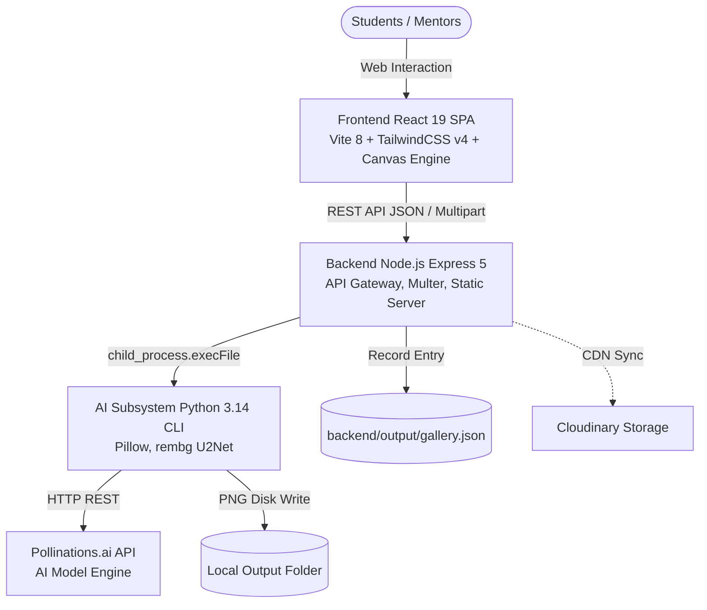

# MindX Game Asset Generator & Character Builder

<div align="center">


**An interactive 2D game asset studio (Backgrounds, Sprites, Animation Tilesheets, Environment Tilesets) and 7-model modular Character & Vehicle Studio designed for MindX students building games in Scratch, GameMaker, Godot, and Unity.**

[Features](#-core-features) • [Architecture](#-system-architecture) • [Quickstart](#-quickstart-guide) • [Technical Reports](#-technical-documentation--audit) • [Credits](#-credits--asset-licensing)

</div>

---

> [!IMPORTANT]
> **CURRENT PROJECT STATUS (AS-BUILT v1.4.0)**
> - **Stage**: Production Ready / Responsive Multi-Device Studio (Version `v1.4.0`).
> - **7 Interactive Character & Asset Studio Models**:
>   - 🧙 **Fantasy Chibi RPG (48x48)**: 30 races, hairstyles, armor sets, weapons, and pixel shadows.
>   - 🧝 **Classic JRPG Pipoya (32x32)**: 4-direction spritesheet characters with live canvas walk/attack animations, outfits, hats, wings, ears, and tails.
>   - 🪖 **Spec-Ops Soldier (32x32)**: Tactical vests, NVG helmets, combat rifles, and live action preview.
>   - 🏎️ **Top-Down Vehicles (160x160)**: 57 centered vehicles across 6 directions, directional road & track surfaces (`Asphalt Road`, `Race Track`, `Parking Stall`, `Off-Road Dirt`), dual directional headlight beams, GT racing stripes, police strobe beacons, twin nitro flames, and drift smoke.
>   - 💎 **In-Game Props & Relics (48x48)**: 260+ weapons, potions, chests, pedestals, and magical auras.
>   - 👾 **Mutant Monster Builder**: Kenney CC0 modular skeletons (A–F) with dynamic HSL color palettes.
>   - 👽 **Sci-Fi Alien Builder**: Extraterrestrial bodies, brainwave antennas, tentacles, and bio-palettes.
> - **Multi-Viewport Responsive Design (`280px` ➔ `1440px+`)**: Seamless layout adaptation from ultra-narrow split windows (`280px`) and mobile phones (`393px`) to 2-column tablets (`768px`) and 3-column desktop studios (`1440px+`).

---

## 🎨 Visual Preview

| Character Studio (7 Real-Time Canvas Models) | AI Asset Generator (2D Game Art) |
| :---: | :---: |
|  |  |
| *Modular character, vehicle & prop customization with AI animation export* | *Pixel art styles, perspective controls, and resolutions* |

---

## 🚀 Core Features

- **7-Model Character & Vehicle Studio**: Real-time HTML5 Canvas compositor with HSL color tinting, directional vehicle lighting/roads, and live spritesheet walk/attack animation.
- **Responsive Multi-Device Workspace**: Split-Stage mobile layout, 2-column tablet workspace, and 3-column desktop studio with a native-style Mobile Bottom Navigation Bar.
- **AI Background Generator**: Generates 2D game environments with standard aspect ratios (16:9 HD, 4:3 classic, 9:16 vertical) and lighting controls.
- **2D Game Sprites**: Generates characters, monsters, and items with isolated silhouettes and multiple perspectives (Front, Side, Back, 3/4).
- **Animation Tilesheet & 5x3 Grid AI Generator**: Generates 10-frame horizontal strips or 15-frame multi-action sprite sheets with auto-computed slicing metadata.
- **Inline Spritesheet Studio & Inspector**: Client-side smart flood-fill background removal, interactive grid matrix, live FPS player, and ZIP frame exporter.
- **Asset Showcase Gallery**: Centralized library with instant category filtering and direct PNG download.

---

## 🏗 System Architecture

MindXAsset uses a **3-Tier Monorepo Hybrid Architecture** combining Node.js Express with Python computer vision and React 19 Canvas rendering:



---

## ⚡ Quickstart Guide

### System Prerequisites
- **Node.js**: v18.x or higher (v20 LTS recommended).
- **Python**: 3.10 - 3.14 with `venv` installed.
- **Browser**: Modern Chromium, Firefox, or Safari.

### Step 1: Clone the repository
```bash
git clone https://github.com/JunWinpro/MindXAsset.git
cd MindXAsset
```

### Step 2: Start Backend Server (Port 5000)
```bash
cd backend
npm install
# npm install automatically runs setup-python.js to create the Python venv
cp .env.example .env
node server.js
```
*API server ready at: `http://localhost:5000`*.

### Step 3: Start Frontend Client (Port 5173)
```bash
cd ../frontend
npm install
npm run dev
```
*Open your browser and navigate to: **`http://localhost:5173`**.*

---

## 📚 Technical Documentation & Audit

All architectural and engineering audits are centralized in the [`docs/`](docs/) directory:

- 📋 **[System Specification (docs/SPEC.md)](docs/SPEC.md)**
- 🧹 **[Cleanup & Optimization Plan (docs/CLEANUP_PLAN.md)](docs/CLEANUP_PLAN.md)**
- 📖 **[Maintenance Guide (docs/MAINTENANCE_GUIDE.md)](docs/MAINTENANCE_GUIDE.md)**
- 📊 **[Project Status Report (docs/PROJECT_STATUS.md)](docs/PROJECT_STATUS.md)**
- 🛡 **[QA Audit Report (docs/QA_REPORT.md)](docs/QA_REPORT.md)**
- 🧪 **[Master Test Plan (docs/TEST_PLAN.md)](docs/TEST_PLAN.md)**
- 🗺 **[Development Roadmap (docs/DEVELOPMENT_PLAN.md)](docs/DEVELOPMENT_PLAN.md)**
- ⚖️ **[Architecture Decisions (docs/DECISIONS.md)](docs/DECISIONS.md)**
- 📝 **[Task Briefs (docs/TASK_BRIEFS.md)](docs/TASK_BRIEFS.md)**
- 🏗 **[Architecture Guide (docs/ARCHITECTURE.md)](docs/ARCHITECTURE.md)**
- 🔍 **[Domain Glossary (docs/GLOSSARY.md)](docs/GLOSSARY.md)**
- 🧭 **[Documentation Hub (docs/README.md)](docs/README.md)**

---

## 🎁 Credits & Asset Licensing

- **Application Source Code**: Licensed under the [MIT License](LICENSE) © 2026 MindX Technology School / JunWinpro.
- **Monster Builder Asset Pack**: Special thanks to **Kenney (www.kenney.nl)** for providing the **Monster Builder Pack (1.0)** under **Creative Commons Zero (CC0)**.
- **Pipoya RPG Sprites**: Special thanks to **Pipoya (pipoya.itch.io)** for the 2D RPG character assets.
- **Top-Down Vehicles**: Special thanks to **@MinZiin_** and **Filip Hron (Flipped Fleet)** for the top-down vehicle sprite collections.
- **AI Infrastructure**: Powered by [Pollinations.ai](https://pollinations.ai).
