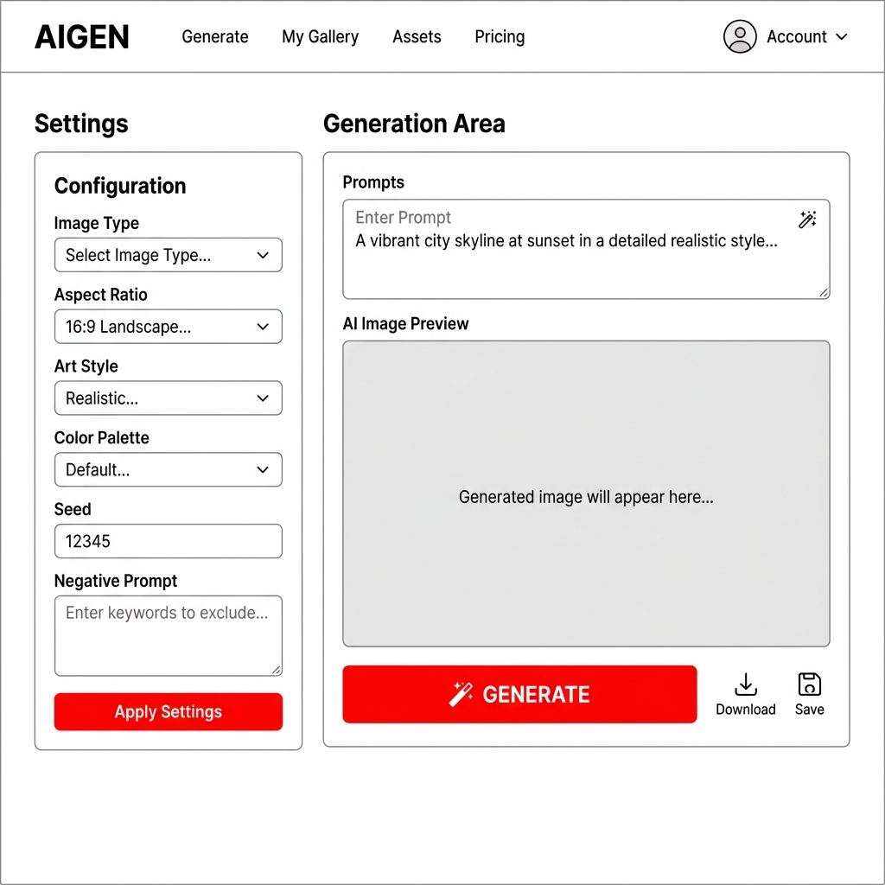
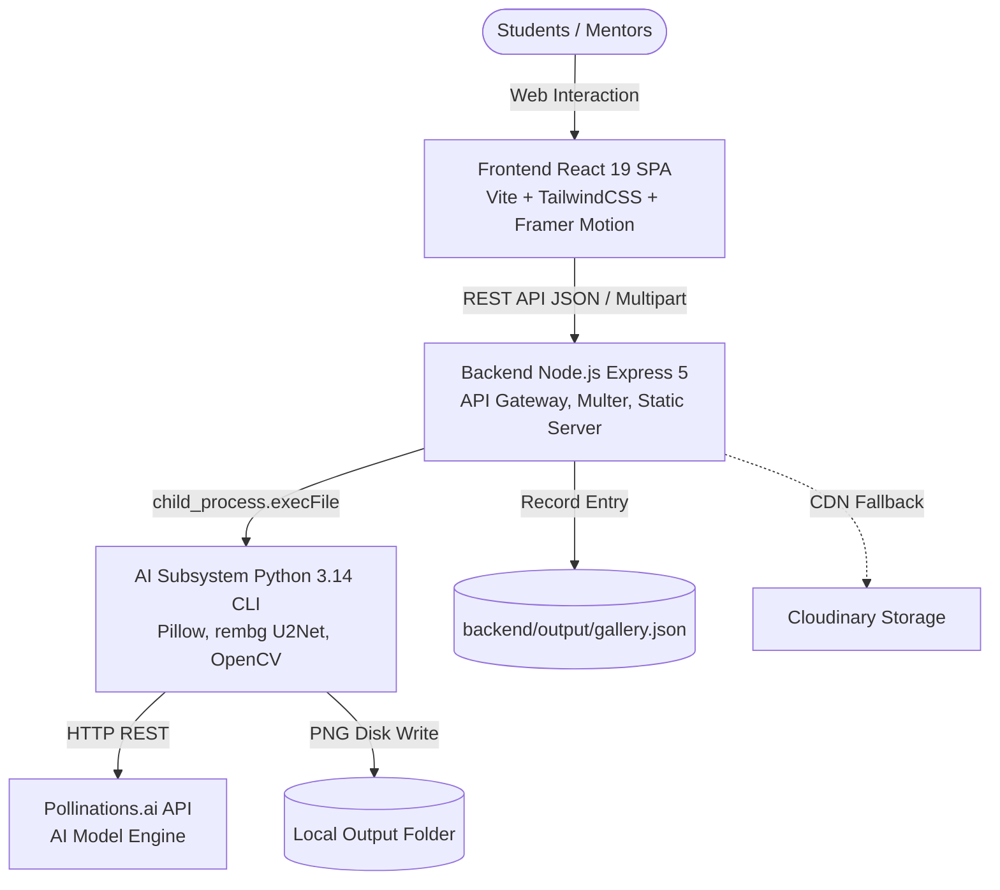

# MindX Game Asset Generator & Character Builder

<div align="center">


**A visual studio for generating 2D game assets (Backgrounds, Sprites, Animation Tilesheets, Environment Tilesets) and custom modular monster avatars for student projects in Scratch, GameMaker, and Unity.**

[Features](#-core-features) • [Architecture](#-system-architecture) • [Quickstart](#-quickstart-guide) • [Technical Reports](#-technical-documentation--audit) • [Credits](#-credits--asset-licensing)

</div>

---

> [!IMPORTANT]
> **CURRENT PROJECT STATUS (AS-BUILT)**
> - **Stage**: Prototype / Alpha MVP (Version `v0.3.0`).
> - **Verified Progress**: **`56.0%`** (Calculated via 7-pillar weighted formula with evidence in [`docs/PROJECT_STATUS.md`](docs/PROJECT_STATUS.md)).
> - **Fully Working**:
>   - **Monster Character Builder**: Real-time canvas avatar customization using Kenney CC0 assets.
>   - AI Background Generator (16:9, 4:3, 9:16) and 2D Sprites via Pollinations.ai.
>   - **Animation Previewer**: Real-time multi-frame preview with customizable FPS and backgrounds.
>   - Post-processing retro pixel art pipeline and transparent PNG exports.
> - **Under Active Improvement**:
>   - Zero Auth (Public access, no user authentication yet).
>   - Storage relies on a flat `backend/output/gallery.json` file rather than a database.
>   - `rembg` background removal requires high RAM (>1.5GB) and is bypassed on free-tier cloud containers.

---

## 🎨 Visual Preview

| Monster Character Builder (Canvas-based) | AI Asset Generator (2D Game Art) |
| :---: | :---: |
|  |  |
| *Modular monster customization with AI animation export* | *Pixel art styles, perspective controls, and resolutions* |

---

## 🚀 Core Features

- **Monster Character Builder**: Real-time HTML5 Canvas builder using Kenney CC0 vector parts (body, eyes, mouth, arms, legs, details) with color tinting and layer stacking.
- **AI Background Generator**: Generates 2D game environments with standard aspect ratios (16:9 HD, 4:3 classic, 9:16 vertical) and lighting controls.
- **2D Game Sprites**: Generates characters, monsters, and items with isolated silhouettes and multiple perspectives (Front, Side, Back, 3/4).
- **Animation Tilesheet Generator**: Generates 10-frame horizontal sprite sheets with auto-computed slicing metadata.
- **Environment Tilesets**: Generates 8-column 32x32px seamless grid sheets for GameMaker and Tiled.
- **Image-to-Pixel Sprite**: Converts user-uploaded images (<=10MB) into retro pixel art sprites with automated background removal.
- **Animation Previewer**: Live animation player with configurable frame rates (1-60 FPS) and background switches.
- **Asset Showcase Gallery**: Centralized library with instant filtering and direct download.

---

## 🏗 System Architecture

MindXAsset uses a **3-Tier Monorepo Hybrid Architecture** combining the asynchronous network performance of Node.js with the computer vision capabilities of Python:



---

## ⚡ Quickstart Guide

### System Prerequisites
- **Node.js**: v18.x or higher (v20 LTS recommended).
- **Python**: 3.10 - 3.14 with `venv` installed.
- **Browser**: Modern Chromium, Firefox, or Safari.

### Step 1: Clone the repository
```bash
git clone https://github.com/JunWinpro/MindXAsset.git
cd MindXAsset
```

### Step 2: Start Backend Server (Port 5000)
```bash
cd backend
npm install
# npm install will automatically run setup-python.js to create the venv
cp .env.example .env
node server.js
```
*API server ready at: `http://localhost:5000`*.

### Step 3: Start Frontend Client (Port 5173)
```bash
cd ../frontend
npm install
npm run dev
```
*Open your browser and navigate to: **`http://localhost:5173`**.*

---

## 📚 Technical Documentation & Audit

All architectural and engineering audits are centralized in the [`docs/`](docs/) directory:

- 📋 **[System Specification (docs/SPEC.md)](docs/SPEC.md)**: Clear as-built vs as-intended feature breakdown.
- 📊 **[Project Status Report (docs/PROJECT_STATUS.md)](docs/PROJECT_STATUS.md)**: 56.0% verified metrics and git history.
- 🛡 **[QA Audit Report (docs/QA_REPORT.md)](docs/QA_REPORT.md)**: Full security audit, npm vulnerabilities, and quality assessment.
- 🧪 **[Master Test Plan (docs/TEST_PLAN.md)](docs/TEST_PLAN.md)**: Testing pyramid and 40 prioritized test cases.
- 🗺 **[Development Roadmap (docs/DEVELOPMENT_PLAN.md)](docs/DEVELOPMENT_PLAN.md)**: 4-phase plan to reach 95% production readiness.
- ⚖️ **[Architecture Decisions (docs/DECISIONS.md)](docs/DECISIONS.md)**: ADR-01 through ADR-09 records.
- 📝 **[Task Briefs (docs/TASK_BRIEFS.md)](docs/TASK_BRIEFS.md)**: 5 actionable task guides for AI/human developers.
- 📖 **[Architecture Guide (docs/ARCHITECTURE.md)](docs/ARCHITECTURE.md)**.
- 🔍 **[Domain Glossary (docs/GLOSSARY.md)](docs/GLOSSARY.md)**.
- 🧭 **[Documentation Hub (docs/README.md)](docs/README.md)**.

---

## 🎁 Credits & Asset Licensing

- **Application Source Code**: Licensed under the [MIT License](LICENSE) © 2026 MindX Technology School / JunWinpro.
- **Monster Builder Asset Pack**: Special thanks to **Kenney (www.kenney.nl)** for providing the **Monster Builder Pack (1.0)** under the **Creative Commons Zero (CC0)** public domain license.
- **AI Infrastructure**: Powered by the open API ecosystem at [Pollinations.ai](https://pollinations.ai).
