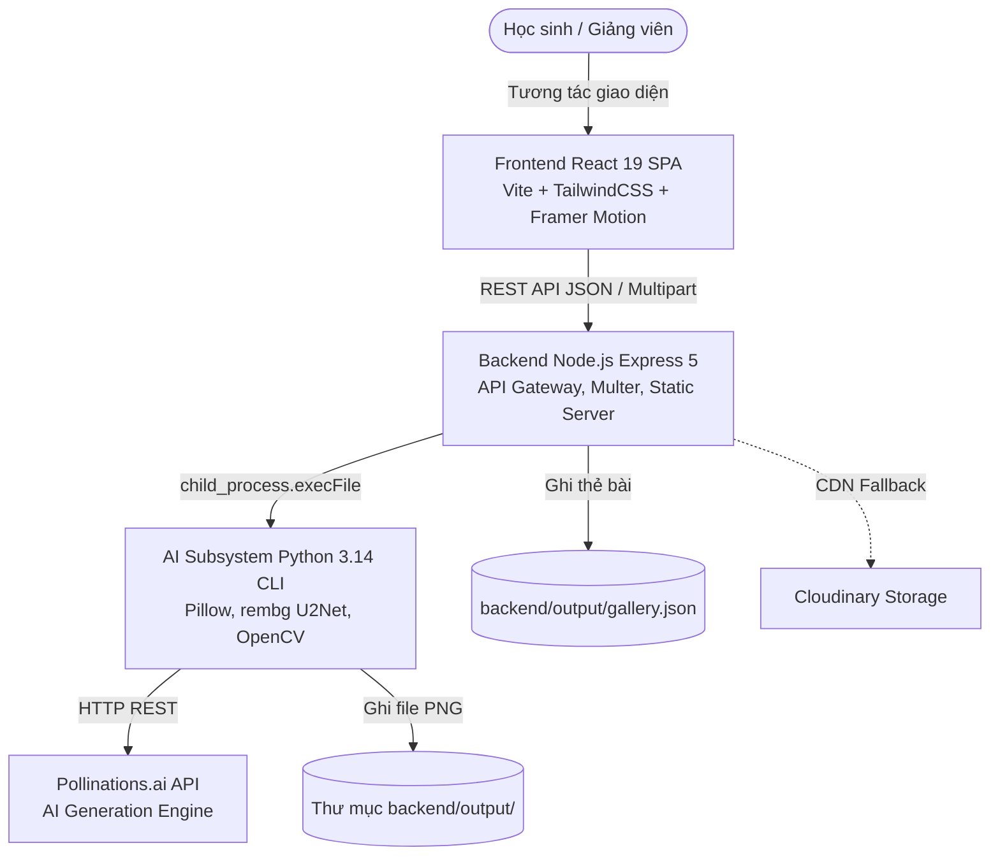

# MindX Game Asset Generator & Character Builder

<div align="center">


**Studio trực quan tạo tài nguyên đồ họa game 2D (Background, Sprite, Animation Tilesheet, Tileset) và lắp ghép quái vật tùy biến dành cho học sinh MindX làm game trên Scratch, GameMaker và Unity.**

[Khám Phá Tính Năng](#-tính-năng-cốt-lõi) • [Kiến Trúc](#-kiến-trúc-hệ-thống) • [Cài Đặt Nhanh](#-hướng-dẫn-cài-đặt--chạy-nhanh) • [Báo Cáo Kỹ Thuật](#-tài-liệu-kỹ-thuật--kiểm-toán) • [Ghi Công](#-ghi-công--bản-quyền-tài-sản)

</div>

---

> [!IMPORTANT]
> **CALLOUT TRẠNG THÁI HIỆN TẠI CỦA DỰ ÁN (AS-BUILT STATUS)**
> - **Giai đoạn**: Prototype / Alpha MVP (Phiên bản `v0.3.0`).
> - **Tiến độ đã kiểm chứng**: **`56.0%`** (tính theo công thức 7 trụ cột có bằng chứng tại [`docs/PROJECT_STATUS.md`](docs/PROJECT_STATUS.md)).
> - **Cái gì chạy mượt mà**:
>   - Xưởng ghép quái vật **Monster Character Builder** trực quan trên Canvas với tài sản Kenney CC0.
>   - Sinh Background AI (16:9, 4:3, 9:16) và Sprite 2D qua Pollinations.ai.
>   - Bộ tua chuyển động hoạt ảnh **Animation Previewer** với điều khiển FPS thời gian thực.
>   - Xử lý hậu kỳ pixel art retro và xuất file PNG trong suốt.
> - **Cái gì chưa làm / Đang cải tiến**:
>   - Chưa có hệ thống đăng nhập tài khoản (chạy chế độ mở công khai Zero Auth).
>   - Chưa kết nối cơ sở dữ liệu thật (lưu danh mục vào file JSON phẳng `backend/output/gallery.json`).
>   - Tính năng tách nền `rembg` tốn nhiều RAM nên tạm tắt trên các gói máy chủ đám mây miễn phí.

---

## 🎨 Minh Họa Giao Diện (Visual Preview)

| Monster Character Builder (Canvas Trực Quan) | AI Asset Generator (Sinh Ảnh 2D Đa Dạng) |
| :---: | :---: |
|  |  |
| *Lắp ráp thân, mắt, miệng, sừng và xuất AI animation* | *Tùy biến phong cách Pixel Art, góc nhìn và kích thước* |

---

## 🚀 Tính Năng Cốt Lõi (Features)

| Phân hệ / Tính năng | Mô tả chi tiết | Trạng thái kỹ thuật |
| :--- | :--- | :---: |
| **1. Monster Character Builder** | Lắp ghép quái vật từ thư viện vector Kenney CC0 (màu thân, mắt, miệng, tay, chân, phụ kiện). Tự do đổi màu, lật ảnh, preview trực tiếp trên HTML5 Canvas. | **Hoạt động tốt** `[ĐÃ XÁC MINH]` |
| **2. Sinh Background AI** | Tạo ảnh phong cảnh 2D không chứa nhân vật, chuẩn tỉ lệ màn hình game (16:9 HD, 4:3 cổ điển, 9:16 dọc) kèm hiệu ứng thời gian ngày/đêm/hoàng hôn. | **Hoạt động tốt** `[ĐÃ XÁC MINH]` |
| **3. Sinh Sprite Độc Lập** | Sinh nhân vật, quái vật, vật phẩm (items) độc lập với góc nhìn Front, Side, Back, 3/4. Tự động xử lý viền sắc nét, nền trong suốt. | **Hoạt động tốt** `[ĐÃ XÁC MINH]` |
| **4. Sinh Animation Tilesheet** | Sinh dải ảnh chuyển động liên hoàn 10 frame cho các hành động (running, walking, idle, attack...), tự động tính toán metadata tọa độ cắt khung. | **Hoạt động** `[ĐÃ XÁC MINH]` |
| **5. Sinh Environment Tileset** | Sinh lưới ô địa hình (đất, đá, cỏ, nước...) kích thước 16x16, 32x32, 64x64 px khớp viền cho GameMaker và Tiled Map Editor. | **Hoạt động tốt** `[ĐÃ XÁC MINH]` |
| **6. Image to Pixel Sprite** | Tải ảnh vẽ tay hoặc ảnh chụp bất kỳ (<= 10MB) -> Tách nền thông minh -> Pixelate retro theo kích thước block tùy chỉnh. | **Hoạt động** `[ĐÃ XÁC MINH]` |
| **7. Animation Previewer** | Bộ tua khung hoạt ảnh mượt mà, cho phép kiểm tra tốc độ frame (1-60 FPS), đổi hình nền bối cảnh (dungeon, grid, dark) trước khi tải. | **Hoạt động tốt** `[ĐÃ XÁC MINH]` |
| **8. Thư Viện Tài Nguyên (Gallery)** | Lưu trữ lịch sử toàn bộ asset đã sinh, hỗ trợ lọc theo loại, xem lại modal và tải file PNG trực tiếp. | **Hoạt động** `[ĐÃ XÁC MINH]` |

---

## 🏗 Kiến Trúc Hệ Thống (Architecture)

MindXAsset được tổ chức theo mô hình **Monorepo 3 khối (Hybrid Architecture)** nhằm tối ưu hóa hiệu năng I/O mạng của Node.js kết hợp sức mạnh xử lý đồ họa của Python:



### Cấu trúc thư mục thực tế
```
MindXAsset/
├── backend/                  # Máy chủ Express & AI Subsystem
│   ├── ai_module/            # Python CLI & logic sinh ảnh cốt lõi
│   │   ├── asset_generator.py# Logic thuật toán xử lý ảnh
│   │   ├── cli.py            # Entry point dòng lệnh
│   │   └── requirements.txt  # Thư viện Python
│   ├── output/               # Lưu trữ ảnh sinh ra & gallery.json
│   ├── uploads/              # Thư mục tạm nhận ảnh upload (tự động xóa)
│   ├── server.js             # Máy chủ API trung tâm (Port 5000)
│   └── setup-python.js       # Script tự động tạo virtualenv khi deploy
├── frontend/                 # Giao diện người dùng React 19 SPA
│   ├── public/assets/        # Thư viện quái vật Kenney CC0 & pixel art
│   ├── src/
│   │   ├── components/       # AnimationPreview, Header, Modals...
│   │   ├── pages/            # Home, Generator, CharacterBuilder, Gallery
│   │   └── App.jsx           # Bộ định tuyến React-Router
│   └── package.json
└── docs/                     # Toàn bộ hồ sơ kỹ thuật, kiểm toán & quyết định
```

---

## ⚡ Hướng Dẫn Cài Đặt & Chạy Nhanh (Quickstart)

### Yêu cầu hệ thống
- **Node.js**: Phiên bản `18.x` trở lên (Khuyến nghị Node.js 20 LTS).
- **Python**: Phiên bản `3.10` đến `3.14` (có sẵn công cụ `venv`).
- **Trình duyệt**: Google Chrome, Microsoft Edge hoặc Firefox phiên bản mới nhất.

---

### Bước 1: Clone kho mã về máy
```bash
git clone https://github.com/JunWinpro/MindXAsset.git
cd MindXAsset
```

---

### Bước 2: Cài đặt và khởi chạy Backend (Cổng 5000)
Mở cửa sổ Terminal thứ nhất:
```bash
cd backend
npm install
# Quá trình npm install sẽ tự động kích hoạt script setup-python.js
# để tạo virtualenv tại backend/ai_module/venv và cài đặt requirements.txt.

# Sao chép file cấu hình môi trường
cp .env.example .env

# Khởi chạy server
node server.js
```
*Server API sẽ sẵn sàng tại: `http://localhost:5000`*.

---

### Bước 3: Cài đặt và khởi chạy Frontend (Cổng 5173)
Mở cửa sổ Terminal thứ hai:
```bash
cd frontend
npm install

# Khởi chạy máy chủ phát triển
npm run dev
```
*Mở trình duyệt và truy cập: **`http://localhost:5173`** để bắt đầu sáng tạo.*

---

## 🛠 Xử Lý Sự Cố Thường Gặp (Troubleshooting)

| Sự cố | Nguyên nhân | Cách khắc phục |
| :--- | :--- | :--- |
| **Lỗi `429 Too Many Requests`** | API Pollinations đang bị nghẽn mạng hoặc quá tải. | Hệ thống đã có bộ lọc thông báo tiếng Việt; vui lòng chờ 10-30 giây và bấm tạo lại. |
| **Lỗi `Command failed / Out of Memory`** | Máy chủ yếu không đủ RAM chạy thư viện tách nền `rembg`. | Mở file `.env` ở backend, thêm dòng `DISABLE_REMBG=true` để chuyển sang chế độ pixelate nhanh không tốn RAM. |
| **Frontend báo lỗi kết nối Network Error** | Backend chưa được bật hoặc chạy sai cổng. | Đảm bảo terminal backend đang chạy `node server.js` và lắng nghe tại cổng `5000`. |
| **Lỗi thiếu môi trường Python khi chạy** | `setup-python.js` chưa chạy thành công do quyền hạn. | Chạy thủ công: `cd backend/ai_module && python -m venv venv && venv\Scripts\pip install -r requirements.txt`. |

---

## 📚 Tài Liệu Kỹ Thuật & Kiểm Toán (Documentation)

Dự án được hệ thống hóa toàn diện theo tiêu chuẩn kiểm toán khắt khe tại thư mục [`docs/`](docs/):

- 📋 **[Đặc Tả Hiện Trạng (docs/SPEC.md)](docs/SPEC.md)**: Phân định rạch ròi as-built vs as-intended.
- 📊 **[Báo Cáo Tiến Độ (docs/PROJECT_STATUS.md)](docs/PROJECT_STATUS.md)**: Ma trận đo lường chi tiết 56.0% kèm lịch sử git.
- 🛡 **[Báo Cáo Kiểm Toán (docs/QA_REPORT.md)](docs/QA_REPORT.md)**: Báo cáo chất lượng toàn diện, lỗ hổng npm và phân tích rủi ro.
- 🧪 **[Kế Hoạch Kiểm Thử (docs/TEST_PLAN.md)](docs/TEST_PLAN.md)**: Kim tự tháp kiểm thử và 40 test case ưu tiên cao.
- 🗺 **[Lộ Trình Phát Triển (docs/DEVELOPMENT_PLAN.md)](docs/DEVELOPMENT_PLAN.md)**: Kế hoạch 4 giai đoạn nâng cấp lên 95%.
- ⚖️ **[Hồ Sơ Quyết Định (docs/DECISIONS.md)](docs/DECISIONS.md)**: 9 bản ghi kiến trúc (ADR-01 đến ADR-09).
- 📝 **[Bản Giao Việc (docs/TASK_BRIEFS.md)](docs/TASK_BRIEFS.md)**: 5 nhiệm vụ chi tiết cho các phiên làm việc tiếp theo.
- 📖 **[Sổ Tay Kiến Trúc Cho Người Mới (docs/ARCHITECTURE.md)](docs/ARCHITECTURE.md)**.
- 🔍 **[Từ Điển Thuật Ngữ Nghiệp Vụ (docs/GLOSSARY.md)](docs/GLOSSARY.md)**.
- 🧭 **[Trung Tâm Tài Liệu (docs/README.md)](docs/README.md)**.

---

## 🎁 Ghi Công & Bản Quyền Tài Sản (Credits & Licensing)

- **Mã nguồn ứng dụng**: Được phát hành theo giấy phép [MIT License](LICENSE) © 2026 MindX Technology School / JunWinpro.
- **Tài sản đồ họa Monster Pack**: Trân trọng cảm ơn **Kenney (www.kenney.nl)** đã sáng tạo và đóng góp bộ **Monster Builder Pack (1.0)** tuyệt đẹp cho cộng đồng theo giấy phép hoàn toàn miễn phí **Creative Commons Zero (CC0)**.
- **Nền tảng AI**: Sử dụng hạ tầng tạo sinh mở từ cộng đồng [Pollinations.ai](https://pollinations.ai).

---

<div align="center">
Made with ❤️ for MindX Students & Mentors.
</div>
