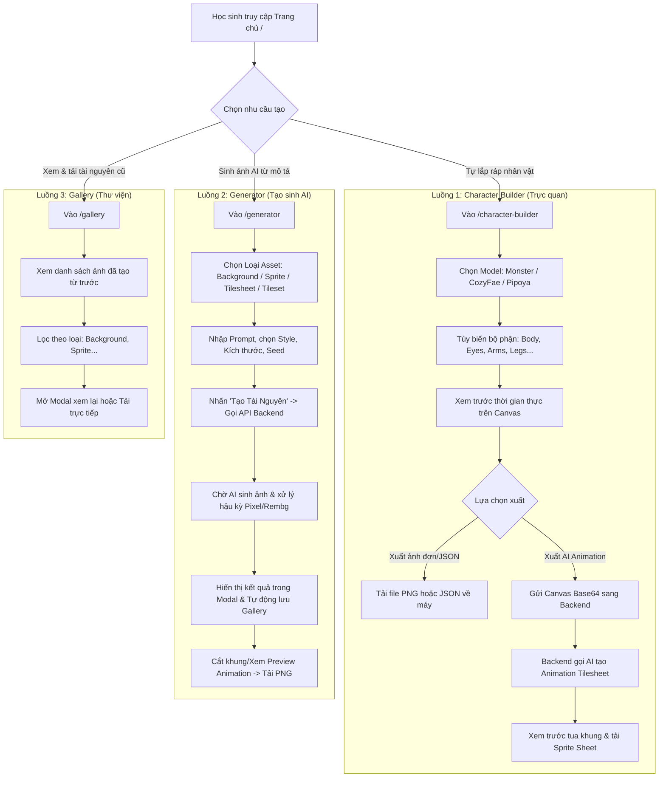

# PHÂN TÍCH SẢN PHẨM & DỊCH NGƯỢC Ý ĐỒ THIẾT KẾ (PRODUCT ANALYSIS)

- **Dự án**: MindXAsset (MindX Game Asset Generator & Character Builder)
- **Phương pháp**: Reverse-Engineering từ giao diện, mã nguồn, commit log và tài liệu SRS.
- **Quy tắc phân định**:
  - `[ĐÃ XÁC MINH]`: Tính năng đã thấy mã chạy thật trong codebase.
  - `[SUY LUẬN]`: Ý đồ sản phẩm được suy luận từ giao diện, tên hàm hoặc tài liệu.
  - `[AS-INTENDED]`: Ý đồ được nhắc tới trong tài liệu nhưng mã chưa làm hoặc khác biệt.
  - `[AS-BUILT]`: Thực tế vận hành của hệ thống.

---

## 1. Định Vị Sản Phẩm, Người Dùng Mục Tiêu & Giá Trị Cốt Lõi

### 1.1 Vấn đề cần giải quyết `[SUY LUẬN từ SRS & Home.jsx]`
- Học sinh học lập trình game tại MindX (đặc biệt là các lớp Scratch, GameMaker, Python Game, Unity 2D) thường gặp bế tắc lớn ở khâu đồ họa: không biết vẽ, tìm ảnh trên Google thì bị dính nền trắng/đen, kích thước cọc cạch, phong cách lộn xộn, và không có hoạt ảnh (animation frames) để nhân vật di chuyển.
- Các công cụ AI tạo ảnh phổ thông (Midjourney, DALL-E) thường sinh ra ảnh đơn lẻ tỉ lệ ngẫu nhiên, chứa nhiều chi tiết rườm rà, không thể tạo sprite sheet chuyển động liền mạch và không có nền trong suốt (transparent PNG) dùng ngay được cho game engine.

### 1.2 Người dùng mục tiêu & Chân dung (Personas) `[SUY LUẬN]`
1. **Persona 1: Bé Minh (11-14 tuổi) - Học sinh lớp GameMaker/Scratch tại MindX**
   - *Đặc điểm*: Thích sáng tạo, không biết vẽ pixel art hay Photoshop, muốn có ngay nhân vật và bối cảnh hiệp sĩ/quái vật theo ý tưởng của mình để gắn vào game nộp đồ án.
   - *Rào cản*: Dễ nản nếu form quá phức tạp, tiếng Anh hạn chế, cần giao diện trực quan, có preview tức thì.
2. **Persona 2: Thầy Hoàng (24 tuổi) - Giảng viên / Mentor bộ môn Game tại MindX**
   - *Đặc điểm*: Hướng dẫn học sinh hoàn thiện sản phẩm cuối khóa; cần một công cụ sinh tài nguyên đồng bộ phong cách (Pixel Art, Chibi) cho cả lớp mà không vi phạm bản quyền thương mại.
   - *Nhu cầu*: Tải file PNG chuẩn kích thước (32x32, 64x64, 16:9), có file spritesheet kèm metadata cắt khung sẵn.

### 1.3 Các việc cần hoàn thành (Jobs-To-Be-Done - JTBD) `[SUY LUẬN]`
- *JTBD-1*: "Khi làm game màn hình ngang, tôi muốn tạo nhanh một bức ảnh nền 16:9 phong cảnh rừng cây ban đêm không có người, để game có không gian bối cảnh đồng nhất."
- *JTBD-2*: "Khi tạo nhân vật chính, tôi muốn ghép một con quái vật từ các bộ phận có sẵn và xuất hoạt ảnh chạy (running animation), để nhân vật chuyển động sinh động trong Scratch."
- *JTBD-3*: "Khi có sẵn một bức vẽ tay hoặc ảnh chụp nhân vật yêu thích, tôi muốn biến nó thành ảnh pixel art 64x64 đã tách nền, để đưa vào game mà không cần tẩy xóa thủ công."
- *JTBD-4*: "Khi cần tạo map vượt chướng ngại vật, tôi muốn sinh một bộ tileset chứa đất, đá, cỏ khớp viền cạnh nhau, để ráp map dễ dàng trong GameMaker."

---

## 2. Hành Trình Người Dùng Chính (User Journeys)

---

## 3. Kiểm Kê Tính Năng Toàn Diện (Feature Inventory)

| Mã tính năng | Tên tính năng | Mô tả chức năng | Đối tượng | Nơi hiện thực (Code) | Trạng thái sơ bộ |
| :--- | :--- | :--- | :--- | :--- | :---: |
| **FEAT-01** | **Sinh Background AI** | Sinh phong cảnh 2D tỉ lệ 16:9, 4:3, 9:16; thời gian ngày/đêm/hoàng hôn. | Học sinh | `Generator.jsx:26-38` `server.js:210-227` | **Hoạt động** (Lưu local/Cloud) |
| **FEAT-02** | **Sinh Sprite độc lập** | Sinh nhân vật/vật phẩm theo góc nhìn (Front, Side, Back, 3/4), kích thước 32-128px. | Học sinh | `Generator.jsx:39-50` `server.js:229-245` | **Hoạt động** |
| **FEAT-03** | **Sinh Tilesheet Hoạt ảnh** | Sinh dải 10 frame cho hành động (run, walk, attack...), tự tính metadata cắt khung. | Học sinh | `Generator.jsx:51-61` `server.js:247-265` | **Hoạt động một phần** (AI thường sinh khung lệch tỉ lệ) |
| **FEAT-04** | **Sinh Environment Tileset** | Sinh lưới ô địa hình (đất, đá, cỏ...) 16/32/64px cho GameMaker. | Học sinh | `Generator.jsx:62-72` `server.js:267-285` | **Hoạt động** |
| **FEAT-05** | **Pixel Art từ ảnh upload** | Tải ảnh (JPG/PNG <=10MB) -> Xóa nền rembg -> Pixelate theo block & palette. | Học sinh | `Generator.jsx:73-89` `server.js:288-312` | **Hoạt động** (chậm khi load model rembg) |
| **FEAT-06** | **Monster Character Builder** | Ghép quái vật từ thư viện vector Kenney CC0 (màu sắc, mắt, miệng, tay, chân, sừng). | Học sinh | `CharacterBuilder.jsx` `CanvasPreview.jsx` | **Hoạt động mượt mà** |
| **FEAT-07** | **CozyFae & Pipoya Models** | Tùy biến nhân vật RPG / Chibi theo các pack đồ họa bổ sung. | Học sinh | `monster_config.js` `assets_config.js` | **Hoạt động một phần** (cần tuân thủ bản quyền) |
| **FEAT-08** | **Animate Custom Character** | Xuất ảnh Canvas hiện tại sang AI để sinh dải chuyển động hoạt ảnh tương ứng. | Học sinh | `CanvasPreview.jsx` `server.js:341-382` | **Thử nghiệm** (Phụ thuộc Pollinations) |
| **FEAT-09** | **Animation Previewer** | Tua vòng các frame của sprite sheet theo tốc độ FPS tùy chỉnh (1-60 FPS). | Học sinh | `AnimationPreview.jsx` | **Hoạt động tốt** |
| **FEAT-10** | **Gallery & Lưu trữ** | Xem lại lịch sử các asset đã sinh, lọc theo loại, tải file PNG. | Học sinh, GV | `Gallery.jsx` `server.js:82-92` | **Hoạt động** (dùng `gallery.json`) |

---

## 4. Quy Tắc Nghiệp Vụ & Ràng Buộc Hệ Thống (Business Rules)

1. **BR-01 (Giới hạn dung lượng upload)**: Ảnh tải lên từ người dùng bị giới hạn tối đa 10MB (`backend/server.js:24`). Nếu vượt quá, Multer trả mã lỗi `400/500`.
2. **BR-02 (Ràng buộc kích thước pixel)**: Các kích thước sprite chuẩn bị ép về lũy thừa của 2: `32x32`, `64x64`, `128x128` px (`backend/ai_module/asset_generator.py:45`).
3. **BR-03 (Fallback lưu trữ ảnh)**: Khi lưu ảnh, hệ thống luôn thử tải lên Cloudinary trước. Nếu thất bại hoặc chưa điền key, hệ thống tự động fallback lưu vào đường dẫn cục bộ tĩnh `backend/output/...` và phục vụ qua `/output/...` (`backend/server.js:178-182`).
4. **BR-04 (Xử lý giới hạn bộ nhớ trên Cloud)**: Nếu phát hiện biến môi trường `RENDER` hoặc `DISABLE_REMBG=true`, hệ thống tự động bỏ qua thư viện `rembg` nặng để chống crash container (`asset_generator.py:651`).
5. **BR-05 (Quy tắc cắt lưới Tileset)**: Tileset môi trường mặc định chia thành 8 cột (`server.js:271`), kích thước mỗi ô là 32x32px (`server.js:272`).

---

## 5. Phân Quyền & Vai Trò (Roles & Permissions)

- **Thực tế mã nguồn (As-Built)**: **KHÔNG CÓ HỆ THỐNG XÁC THỰC (Zero Auth)** [ĐÃ XÁC MINH].
  - Toàn bộ 7 endpoint của Backend (`/api/generate-*`, `/api/gallery`) đều ở trạng thái công khai (Public).
  - Bất kỳ ai gửi request HTTP đều có thể kích hoạt tiến trình Python CLI sinh ảnh trên server và ghi vào `gallery.json`.
  - Không có bảng `Users`, không có JWT, không có phân quyền Admin/Học sinh.

---

## 6. Khoảng Trống Ý Đồ (Intent Gaps: As-Intended vs As-Built)

| Hạng mục | Tài liệu/Giao diện công bố (As-Intended) | Thực tế mã nguồn (As-Built) | Đánh giá & Hướng xử lý |
| :--- | :--- | :--- | :--- |
| **Đa mô hình AI** | `BAO_CAO_TONG_HOP.md:51` và `Home.jsx:19` tuyên bố hỗ trợ **Hugging Face, Gemini và Pollinations**. | Mã nguồn chỉ gọi duy nhất **Pollinations.ai** (`asset_generator.py:33`). Không có dòng code nào gọi HuggingFace Inference hay Gemini API. | **Mâu thuẫn lớn**: Cần sửa lại tài liệu và UI để phản ánh đúng thực tế, hoặc bổ sung adapter cho HF/Gemini trong tương lai. |
| **Image-to-Image** | `BAO_CAO_TONG_HOP.md:119`: Tính năng biến ảnh tham chiếu thành nhân vật mới. | Bị comment/chặn vì đòi hỏi xác thực/credit trả phí (`asset_generator.py`). | Cần ghi nhận là tính năng đang tạm hoãn (Blocked by external cost). |
| **Lưu trữ CSDL** | `BAO_CAO_TONG_HOP.md:65`: Đề xuất cơ sở dữ liệu cho mở rộng. | Thực tế lưu danh sách ảnh vào file JSON phẳng `backend/output/gallery.json` [ĐÃ XÁC MINH]. | Nguy cơ xung đột ghi đồng thời (race condition) khi nhiều học sinh tạo ảnh cùng lúc. |
| **Tên gói Monster Pack** | Giao diện ghi "Monster Builder" phục vụ tạo quái vật. | Thư mục `Monster/` thực chất là bộ asset vector của tác giả Kenney phân phối theo giấy phép CC0. | Cần bổ sung trang Credits cảm ơn Kenney để chuẩn mực đạo đức phần mềm. |

---

## 7. Các Câu Hỏi Cần Chủ Dự Án Quyết Định (Product Open Questions)

1. Dự án có cần bổ sung tính năng đăng nhập (Google OAuth / MindX Account) cho học sinh để mỗi bạn chỉ xem và quản lý asset của riêng mình hay giữ nguyên chế độ công khai dùng chung như hiện tại?
2. Nhãn truyền thông "Hỗ trợ Hugging Face & Gemini" trên trang chủ có nên được chỉnh sửa lại thành "Sử dụng Pollinations AI Engine" để đảm bảo tính trung thực với người dùng không?
3. Với tính năng Character Builder, chủ dự án có muốn khóa tập trung hoàn thiện bộ **Monster Pack (CC0)** trước để đảm bảo an toàn bản quyền 100%, tạm ẩn các bộ phận của CozyFae chưa có giấy phép thương mại mở rộng không?
