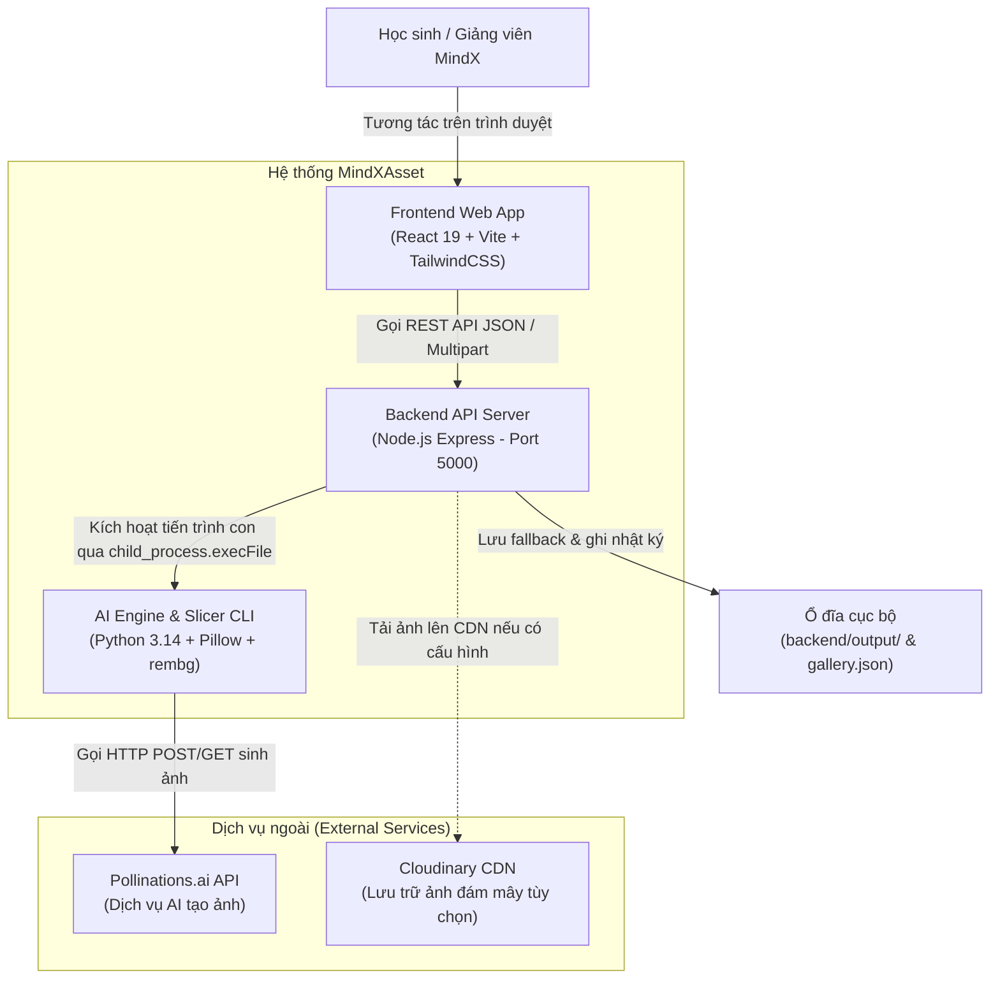
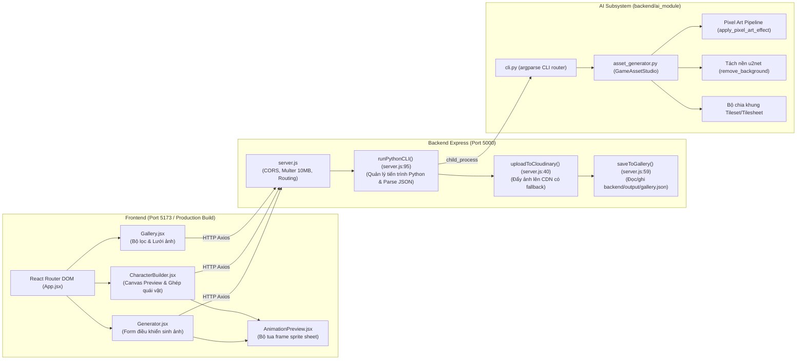
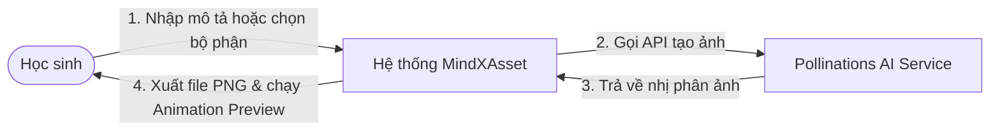
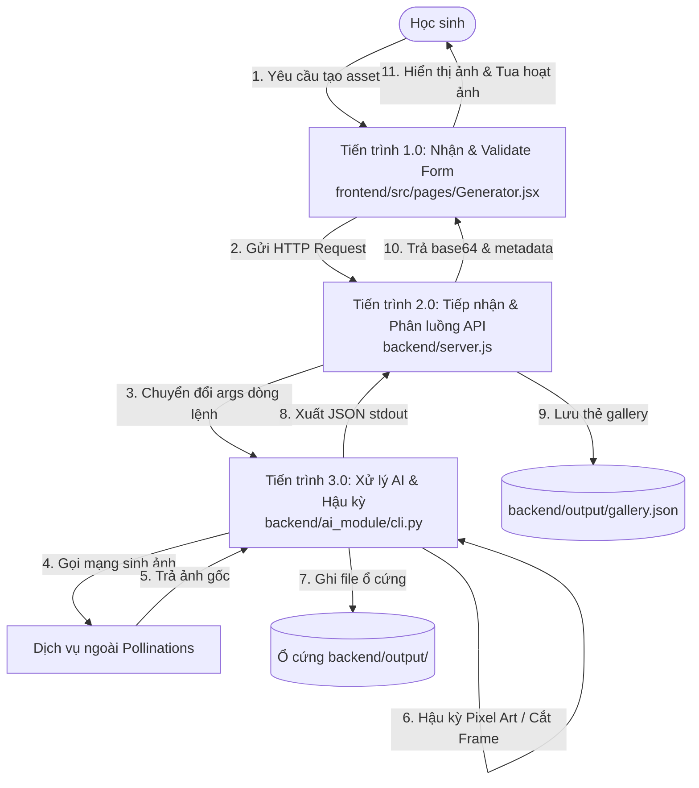

# KIẾN TRÚC HỆ THỐNG & LUỒNG DỮ LIỆU ĐẦU-CUỐI (ARCHITECTURE & DATAFLOW)

- **Dự án**: MindXAsset (MindX Game Asset Generator & Character Builder)
- **Thời gian lập**: 2026-10-14 20:16 (UTC+7)
- **Chuẩn đánh giá**: Truy vết chính xác đến từng file:dòng và sơ đồ hóa bằng Mermaid.

---

## 1. Sơ Đồ Ngữ Cảnh Hệ Thống (System Context - C4 Level 1)



---

## 2. Sơ Đồ Thành Phần Hệ Thống (Component Diagram - C4 Level 2)



---

## 3. Sơ Đồ Luồng Dữ Liệu (DFD Mức 0 & Mức 1)

### 3.1 DFD Mức 0 (Sơ đồ luồng dữ liệu ngữ cảnh)


### 3.2 DFD Mức 1 (Phân rã các tiến trình bên trong)


---

## 4. Năm Luồng Dữ Liệu Đầu-Cuối Then Chốt (End-to-End Key Dataflows)

### Luồng 1: Sinh Background AI (Phong cảnh game 2D)
- **Mục tiêu**: Người dùng nhập mô tả phong cảnh, chọn tỉ lệ (16:9, 4:3), hệ thống sinh ảnh nền không chứa nhân vật.
- **Truy vết mã nguồn**:
  1. *Kích hoạt UI*: Học sinh nhập `"dark dungeon"` tại `frontend/src/pages/Generator.jsx:31`, bấm nút "Tạo Background" (`Generator.jsx:128`).
  2. *Gọi mạng*: Frontend gửi `POST http://localhost:5000/api/generate-background` kèm payload JSON (`Generator.jsx:128-130`).
  3. *Tầng API*: `backend/server.js:210` tiếp nhận; kiểm tra `if (!subject)` (`server.js:212`).
  4. *Khởi tạo tiến trình*: `runPythonCLI()` khởi chạy lệnh: `python cli.py background "dark dungeon" --size background_hd --style pixel_art --out output` (`server.js:218-226`).
  5. *Xử lý AI cốt lõi*: `backend/ai_module/cli.py:90` gọi `GameAssetStudio.generate_background()`. Module enrich prompt thêm `"side-scrolling environment, no characters, no HUD"` (`asset_generator.py:464-470`), gọi HTTP đến Pollinations.ai và lưu file vào `backend/output/backgrounds/`.
  6. *Thu nhận kết quả & Lưu trữ*: Node.js bắt luồng stdout (`server.js:131`), đọc file thành buffer base64 (`server.js:142-143`), gọi bất đồng bộ `saveToGallery()` ghi vào `backend/output/gallery.json` (`server.js:180`).
  7. *Phản hồi & Render*: Trả JSON chứa `image` Data URI và `metadata`. `Generator.jsx` nhận response, tắt loading spinner, hiển thị modal xem trước ảnh toàn màn hình.

```mermaid
sequenceDiagram
    autonumber
    actor User as Học sinh
    participant FE as Frontend (Generator.jsx)
    participant BE as Express (server.js)
    participant PY as Python (cli.py / asset_generator.py)
    participant AI as Pollinations.ai
    participant Disk as Local Disk (output/ & gallery.json)

    User->>FE: Nhập "dark dungeon", chọn 16:9 -> Bấm "Tạo Background"
    FE->>BE: POST /api/generate-background {subject, size_key, style}
    BE->>BE: Validate subject (server.js:212)
    BE->>PY: execFile("python cli.py background ...") (server.js:107)
    PY->>AI: HTTP GET image from pollinations.ai (asset_generator.py)
    AI-->>PY: Trả về binary PNG
    PY->>Disk: Lưu file PNG vào backend/output/backgrounds/
    PY-->>BE: Xuất JSON stdout {file_path, width, height...}
    BE->>Disk: Đọc file -> Base64 & Lưu vào gallery.json (server.js:143, 180)
    BE-->>FE: 200 OK {image: "data:image/png;base64...", metadata}
    FE-->>User: Mở modal hiển thị ảnh & thông báo thành công
```

---

### Luồng 2: Sinh Tilesheet Hoạt Ảnh & Tua Khung (Animation Slicer)
- **Mục tiêu**: Người dùng nhập tên nhân vật và hành động, hệ thống sinh dải ảnh 10 frame ngang, tự động tính tọa độ từng khung và tua vòng chuyển động ngay trên giao diện.
- **Truy vết mã nguồn**:
  1. *Kích hoạt UI*: Người dùng chọn tab "Tilesheet", nhập nhân vật `"ninja"`, hành động `"running"`, chọn 10 frame (`Generator.jsx:51-61`).
  2. *Gọi mạng*: Gửi `POST /api/generate-tilesheet` (`Generator.jsx:136`).
  3. *Tầng API*: `server.js:247` nhận payload; truyền cờ `--slice` cho Python CLI (`server.js:261`).
  4. *Xử lý cắt khung*: Python `generate_tilesheet()` sinh dải ảnh ngang, sau đó thuật toán chia đều chiều rộng ảnh cho số khung hình để tính mảng `FrameMetadata` chứa tọa độ `[ {x: 0, y: 0, w: 64, h: 64}, {x: 64, y: 0, w: 64, h: 64}... ]` (`asset_generator.py:165-172`).
  5. *Đóng gói Metadata phía Node.js*: `server.js:154-173` phân tích mảng frames, xác định `layout_format = 'horizontal'`, `total_frames = 10`, `frame_width = 64`, `frame_height = 64`.
  6. *Hiển thị & Animation Preview*: Frontend mở component `frontend/src/components/AnimationPreview.jsx:45`, sử dụng `requestAnimationFrame` hoặc `setInterval` theo FPS người dùng chọn để vẽ liên tục từng lát cắt lên Canvas, tạo hiệu ứng hoạt ảnh chạy sống động.

---

### Luồng 3: Monster Character Builder & Xuất AI Animate
- **Mục tiêu**: Người dùng tự chọn từng bộ phận quái vật từ Kenney pack, ghép trên Canvas thời gian thực, sau đó gửi ảnh sang AI để sinh dải chuyển động chạy/đánh.
- **Truy vết mã nguồn**:
  1. *Lắp ghép Canvas*: `frontend/src/pages/CharacterBuilder/CanvasPreview.jsx:35-100` load các ảnh PNG từ `public/assets/monster/` theo thứ tự z-index: Body -> Eyes -> Mouth -> Arms -> Legs -> Details.
  2. *Kích hoạt xuất AI*: Người dùng nhấn nút "Tạo Hoạt Ảnh Chạy (AI Animation)" tại `CanvasPreview.jsx:105`.
  3. *Chuyển đổi Base64*: Canvas gọi `canvas.toDataURL('image/png')` tạo chuỗi Base64 (`CanvasPreview.jsx:108`).
  4. *Gọi API*: Gửi `POST /api/generate-custom-character` kèm `config` và `base64_image` (`CanvasPreview.jsx:110`).
  5. *Xử lý tối ưu phía Server*: `server.js:352-368` trích xuất Base64 lưu thành file tạm `backend/uploads/temp_char_*.png`; đọc cấu hình config để tạo câu lệnh prompt tự nhiên: *"A pixel art character with body green, mouth smile, performing running action"*.
  6. *Gọi AI*: Chạy `python cli.py animate-image temp_char.png --subject ...` (`server.js:370-376`).
  7. *Kết quả*: Trả về sprite sheet chuyển động để học sinh tải về hoặc xem trước.

---

### Luồng 4: Tải Ảnh Lên -> Tách Nền & Pixel Hóa (Image to Sprite)
- **Mục tiêu**: Học sinh tải một bức ảnh bất kỳ từ máy tính lên, hệ thống tách bỏ nền cảnh và pixel hóa.
- **Truy vết mã nguồn**:
  1. *Upload*: Học sinh kéo thả ảnh vào `Generator.jsx:75-89`. Form gửi dạng `multipart/form-data` tới `POST /api/generate-from-image` (`Generator.jsx:155`).
  2. *Multer Middleware*: `backend/server.js:22-25` kiểm tra giới hạn 10MB, lưu tạm vào `backend/uploads/<hash>`.
  3. *Tách nền Python*: `asset_generator.py:650-670` gọi thư viện `rembg` chạy mô hình U2Net nhận diện chủ thể và ép kênh Alpha của nền về 0. (Nếu trên Render, kiểm tra cờ `DISABLE_REMBG` để tránh tràn RAM).
  4. *Pixel Art Effect*: Ảnh đã tách nền được resample bằng Box Filter thu nhỏ về 64x64, giảm màu palette, phóng to lại bằng Nearest Neighbor (`asset_generator.py:675-710`).
  5. *Dọn dẹp*: Server xóa file upload trong `uploads/` (`server.js:108-110`) và trả kết quả về giao diện.

---

### Luồng 5: Đọc Thư Viện Tài Nguyên (Gallery Master Read)
- **Mục tiêu**: Người dùng xem danh mục toàn bộ tài nguyên đã được sinh ra trong quá khứ.
- **Truy vết mã nguồn**:
  1. *Mount UI*: `frontend/src/pages/Gallery.jsx:11` gọi `useEffect` kích hoạt hàm `fetchGallery()`.
  2. *Gọi API*: Gửi `GET /api/gallery` (`Gallery.jsx:15`).
  3. *Đọc File*: `backend/server.js:82-92` kiểm tra và đọc tệp `backend/output/gallery.json`, parse thành mảng JSON.
  4. *Lọc & Hiển Thị*: Giao diện nhận mảng, hỗ trợ người dùng bấm tab lọc cục bộ theo `type` (Background, Sprite, Tilesheet, Tileset) và tìm kiếm theo prompt.

---

## 5. Ranh Giới Tin Cậy & Điểm Yếu Kiến Trúc (Trust Boundaries & Architectural Smells)

1. **Ranh giới tin cậy (Trust Boundary)**:
   - Toàn bộ tham số từ người dùng (`subject`, `config`, file upload) đi thẳng vào tham số dòng lệnh CLI (`child_process.execFile`) mà không qua bộ lọc ký tự đặc biệt (sanitization) chặt chẽ. Mặc dù `execFile` an toàn hơn `exec` (không spawn shell trực tiếp), việc truyền chuỗi không kiểm soát vẫn tiềm ẩn nguy cơ nếu có tham số bị rò rỉ vào sub-process.
2. **Vi phạm phân tầng (Layering Violation)**:
   - Server Node.js đóng vai trò vừa là Web Server, vừa là Task Queue, vừa trực tiếp ghi file JSON cục bộ làm Database (`server.js:75`).
   - Xử lý tiến trình dài hạn (Long-running process: AI tạo ảnh mất từ 5-20 giây) bằng kết nối HTTP đồng bộ (Synchronous HTTP request-response). Nếu mạng chập chờn hoặc AI quá tải, client sẽ bị timeout.
3. **Nguy cơ xung đột ghi (Race Condition)**:
   - `saveToGallery()` trong `server.js:59-80` đọc và ghi đè file `gallery.json` một cách đồng bộ mà không có cơ chế khóa tệp (file lock). Hai request hoàn thành cùng lúc có thể làm mất dữ liệu của nhau.
