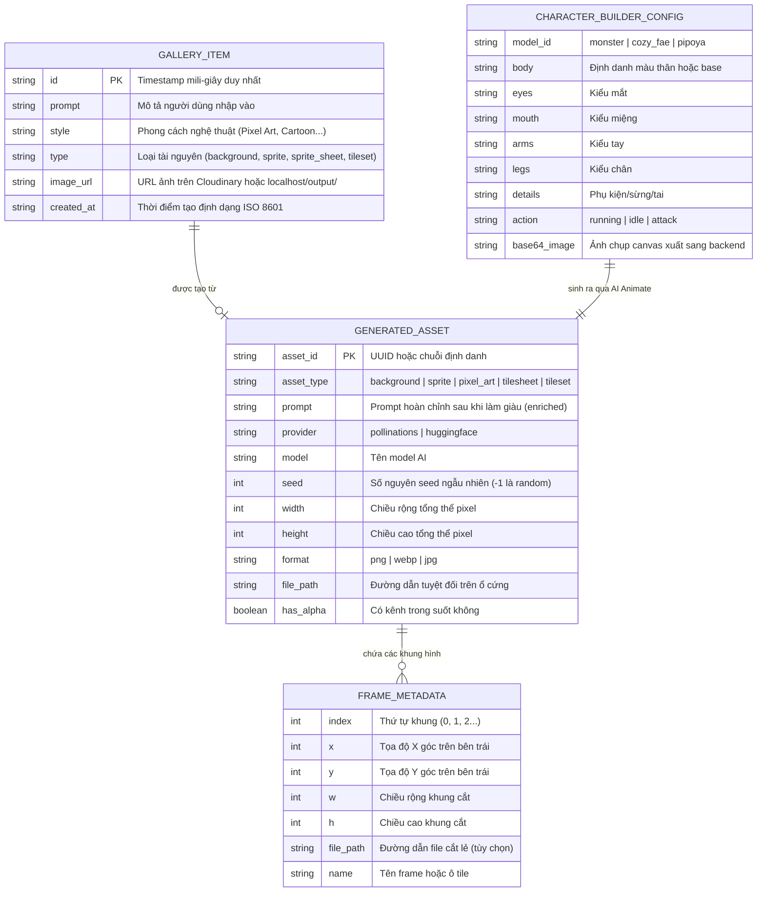

# TỪ ĐIỂN DỮ LIỆU & MÔ HÌNH THỰC THỂ (DATA DICTIONARY & ERD)

- **Dự án**: MindXAsset
- **Thời gian lập**: 2026-10-14 20:10 (UTC+7)
- **Phương pháp**: So sánh đối chiếu chéo giữa 3 nguồn:
  1. *Lưu trữ bền vững (Storage Schema)*: Tệp JSON phẳng `backend/output/gallery.json`.
  2. *Mô hình mã nguồn (Code Models)*: Python `@dataclass GeneratedAsset`, Node.js Express payloads, React Component State.
  3. *Dữ liệu mẫu thực tế*: Các bản ghi đang tồn tại trong `backend/output/gallery.json`.

---

## 1. Sơ Đồ Thực Thể Quan Hệ (ERD - Conceptual Model)

Hệ thống hiện tại chưa sử dụng Cơ sở dữ liệu quan hệ (RDBMS) hay NoSQL mà vận hành theo mô hình cấu trúc dữ liệu phẳng lưu trong file và bộ nhớ:

---

## 2. Bảng Đối Chiếu 3 Nguồn Dữ Liệu (Schema vs Code vs Real Data)

| Thuộc tính | Schema Lưu Trữ (`gallery.json`) | Mô hình Code (`server.js` & `asset_generator.py`) | Dữ liệu thực tế (`backend/output/gallery.json`) | Đánh giá độ lệch & Rủi ro |
| :--- | :--- | :--- | :--- | :--- |
| **ID** | `id: string` | `Date.now().toString()` (`server.js:67`) | `"1788711175471"` | **Khớp**. Dùng timestamp đơn giản, dễ trùng nếu có 2 request trong cùng 1 mili-giây. |
| **Prompt** | `prompt: string` | `prompt \|\| 'Game Asset'` (`server.js:68`) | Chuỗi mô tả đầy đủ kèm từ khóa kỹ thuật pixel art. | **Khớp**. |
| **Style** | `style: string` | `style \|\| 'Pixel Art'` (`server.js:69`) | Một số bản ghi có `"style": "N/A"` (`gallery.json:13, 21, 29`). | **LỆCH**: Khi tạo qua các endpoint không truyền style chuẩn, `server.js` để style thành `"N/A"`, gây lỗi hiển thị badge trên giao diện Gallery. |
| **Type** | `type: string` | `type \|\| 'Asset'` (`server.js:70`) | `"pixel_art"`, `"sprite_sheet"`, `"background"`, `"sprite"` | **LỆCH ĐỊNH DANH**: Trong code Python trả về `asset_type`, khi vào `gallery.json` lại là `type`. Tên gọi chưa đồng bộ (`sprite_sheet` vs `tilesheet`). |
| **Image URL** | `image_url: string` | `url` Cloudinary hoặc `${baseUrl}/${relativePath}` | `"http://localhost:5000/output/pixel_art/..."` | **RỦI RO MÔI TRƯỜNG**: Chứa cứng domain `http://localhost:5000`. Khi deploy lên Cloud (Render/Vercel), URL này bị chết nếu biến `RENDER_EXTERNAL_URL` không được cấu hình. |
| **Created At** | `created_at: string` | `new Date().toISOString()` (`server.js:72`) | `"2026-09-06T16:12:55.471Z"` | **Khớp** chuẩn ISO 8601. |

---

## 3. Từ Điển Dữ Liệu Chi Tiết (Data Dictionary)

### 3.1 Thực thể: `GALLERY_ITEM` (Lưu trữ trong `backend/output/gallery.json`)
- **Mô tả**: Lưu thông tin thẻ bài đại diện cho một ảnh game asset đã được sinh thành công để người dùng xem lại.
- **Nguồn sự thật (Single Source of Truth)**: `backend/output/gallery.json` [ĐÃ XÁC MINH].
- **Cơ chế đồng bộ**: Đọc toàn bộ file vào RAM -> unshift phần tử mới -> ghi đè lại toàn bộ file JSON (`server.js:61-75`).

| Tên trường | Kiểu dữ liệu | Bắt buộc? | Ràng buộc giá trị | Có là PII? | Vòng đời / Lưu giữ |
| :--- | :--- | :---: | :--- | :---: | :--- |
| `id` | String | Có | Khóa chính tự sinh (Unix timestamp ms) | Không | Lưu vĩnh viễn đến khi xóa file JSON |
| `prompt` | String | Có | Tối đa độ dài prompt URL (~2000 ký tự) | Không | Lưu cùng bản ghi |
| `style` | String | Có | `Pixel Art`, `Cartoon`, `Realistic`, `Chibi`, hoặc `N/A` | Không | Lưu cùng bản ghi |
| `type` | String | Có | `background`, `sprite`, `pixel_art`, `sprite_sheet`, `tileset` | Không | Lưu cùng bản ghi |
| `image_url` | String | Có | URL hợp lệ (HTTP/HTTPS) | Không | Lưu cùng bản ghi |
| `created_at`| String | Có | Chuỗi thời gian chuẩn UTC ISO-8601 | Không | Lưu cùng bản ghi |

### 3.2 Thực thể: `GENERATED_ASSET` (Python Dataclass trong bộ nhớ)
- **Mô tả**: Đối tượng dữ liệu kỹ thuật đại diện cho file ảnh sau khi AI sinh và hậu kỳ.
- **Nguồn sự thật**: Bộ nhớ RAM tiến trình Python (`backend/ai_module/asset_generator.py:158`).

| Tên trường | Kiểu dữ liệu | Bắt buộc? | Ràng buộc giá trị | Có là PII? | Mục đích sử dụng |
| :--- | :--- | :---: | :--- | :---: | :--- |
| `asset_id` | String | Có | Định dạng tên file hoặc UUID | Không | Định danh kỹ thuật |
| `asset_type` | String | Có | Thuộc enum 5 loại tài nguyên | Không | Phân loại thư mục lưu trữ |
| `prompt` | String | Có | Chuỗi prompt thô + enriched keywords | Không | Truy vết ngữ cảnh sinh ảnh |
| `provider` | String | Có | `"pollinations"` | Không | Theo dõi nhà cung cấp AI |
| `model` | String | Có | Tên model tạo ảnh (`flux`, `turbo`...) | Không | Đánh giá chất lượng model |
| `seed` | Integer | Có | `-1` hoặc số nguyên dương `[0, 2^32]` | Không | Tái hiện kết quả (reproducibility) |
| `width` | Integer | Có | `> 0`, thường là 32, 64, 128, 512, 1920 | Không | Kích thước ảnh xuất |
| `height` | Integer | Có | `> 0`, thường là 32, 64, 128, 512, 1080 | Không | Kích thước ảnh xuất |
| `format` | String | Có | `"png"` | Không | Định dạng ảnh |
| `file_path` | String | Có | Đường dẫn tệp tồn tại trên ổ cứng | Không | File vật lý trong `backend/output/` |
| `has_alpha` | Boolean | Có | `True` hoặc `False` | Không | Xác định đã tách nền thành công |
| `frames` | Array | Không | Danh sách đối tượng `FrameMetadata` | Không | Dùng cho tilesheet & tileset |
| `warnings` | Array | Không | Mảng các cảnh báo lỗi mềm | Không | Báo cáo rủi ro xử lý |

---

## 4. Kiểm Kê Dữ Liệu Cá Nhân (PII) & Vòng Đời Dữ Liệu (Data Retention)

1. **Kiểm kê dữ liệu cá nhân (PII)**:
   - Hệ thống **KHÔNG thu thập bất kỳ thông tin nhận dạng cá nhân nào (No PII collected)** [ĐÃ XÁC MINH].
   - Không có trường tên thật, email, số điện thoại, địa chỉ IP hay cookies theo dõi người dùng.
   - Dữ liệu duy nhất do người dùng tạo ra là nội dung văn bản mô tả (Prompt) và file ảnh upload (nếu dùng tính năng Sprite from Image). File upload được tự động xóa sau khi xử lý xong (`server.js:108-110`).
2. **Vòng đời & Lưu giữ dữ liệu (Data Lifecycle)**:
   - File upload tạm (`backend/uploads/`): Tồn tại trong thời gian xử lý request (~3-10 giây), sau đó bị `fs.unlink()` xóa bỏ ngay.
   - File kết quả (`backend/output/`): Lưu vĩnh viễn trên ổ cứng máy chủ dev. Trên môi trường Render Free Tier, các file này sẽ bị xóa mất mỗi khi container khởi động lại (ephemeral disk storage).
   - Danh sách Gallery (`gallery.json`): Không có cơ chế phân trang (pagination) hay dọn dẹp định kỳ (cleanup). Nếu người dùng tạo hàng nghìn ảnh, file JSON sẽ phình to và làm chậm mỗi lần đọc/ghi.
